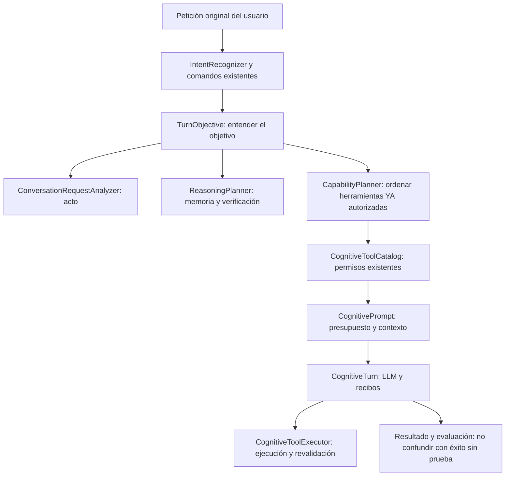

# Salve: comprensión del objetivo y mapa de dependencias (primera fase)

Estado: primera fase implementada en esta rama; **no representa una auditoría ejecutada en un teléfono**.
Base: `main` del 1 de noviembre de 2026, después de la PR #324.

## Diagnóstico del código existente

Antes de este cambio, el mismo turno recorría varias piezas correctas pero sin un
**objeto único** que relacionara su interpretación con el plan de razonamiento y
la selección del catálogo limitado del modelo local:

| Responsabilidad real | Componente existente | Decisión |
| --- | --- | --- |
| Reconocer un acto conversacional | `ConversationRequestAnalyzer` | **Reutilizar**, no crear otro clasificador |
| Reconocer órdenes deterministas | `IntentRecognizer`, comandos específicos | **Conservar** su autorización y precedencia |
| Decidir memoria/verificación | `ReasoningPlanner` y `ReasoningPlan` | **Reutilizar**, nunca repetir sus reglas |
| Seguir tareas y respuestas elípticas | `DialogueFocus` | **Conservar**; no inferir aprobación de una frase aislada |
| Ofrecer herramientas autorizadas | `CognitiveToolCatalog` | **Conservar** como única allowlist del turno |
| Priorizar herramientas según intención | `CapabilityPlanner` | **Reutilizar** su ranking, sin inventar permisos |
| Recortar el catálogo al modelo | `CognitivePrompt.limitTools` | **Conservar** el límite contextual |
| Ejecutar acciones | `CognitiveTurn` → `CognitiveToolExecutor` | **Conservar** validación, recibos y límites |
| Tareas de larga duración | `AgentRuntime` → `AgentEngine` → `AgentPolicy` | **Conservar** el motor persistente separado |
| Evidencia y memoria | `ConversationMemoryGrounding`, `MindRuntime`, `Room` | **Conservar** procedencia y acceso privado |
| Sueño, reflexión y lectura de código | `SleepFocusWorker`, `CodeReviewWorker` | **Conservar** ejecución condicionada a batería y uso |

**Superposición observada, no duplicado demostrado:** hay distintos analizadores de
entrada, pero sus responsabilidades son distintas: actos conversacionales,
comandos explícitos, pistas de memoria, continuidad de la conversación y
ranking de herramientas. Reescribirlos bajo un nuevo `IntentEngine` agravaría
el acoplamiento.

La duplicación evitable era la **coordinación del turno**: el plan que enriquecía
`responseContext` no acompañaba al ciclo que recortaba y ordenaba herramientas.

## Fase 1: un objetivo por turno, sin conceder permisos nuevos



`TurnObjective` es un **marco inmutable**, calculado una sola vez para la vía
conversacional normal. Conserva la misma instancia entre la primera inferencia
y el intento de corrección de esa respuesta. El análisis y el plan son los
existentes. No abre herramientas, no consulta datos privados, no escribe memoria,
no realiza inferencias y no sustituye al agente persistente.

Las vías especializadas de foto y examen mantienen el catálogo supervisado o
simulado que ya utilizaban; no heredan capacidades del objetivo de otro turno.
El controlador sigue comprobando identidad y consentimiento en el momento de
ejecutar las herramientas.

**Esta fase NO centraliza todavía todos los comandos especiales de
`MotorConversacional`**. Migrarlos masivamente sin pruebas por comportamiento
sería arriesgado: hay rutas de historia, voz, cámara, recuerdos, presupuestos,
investigación y accesibilidad con efectos diferentes.

## Fase 1 adicional: autoinspección completa o pendiente, nunca a medias

`CodeDiff.reviewPages` transforma bloques arbitrariamente largos de diferencias
en páginas numeradas **sin recortar líneas**. Si una línea individual excede el
presupuesto, la revisión falla sin marcar el archivo como revisado.

`CodeReviewCycle` guarda un cursor de fragmento por hash de archivo y se
reanuda en la siguiente tanda. Rechaza errores de persistencia; cuando el
presupuesto se agota, deja el parche pendiente. Los tests incluyen un bloque
mucho mayor que 3.000 caracteres, su última línea y la reanudación.

Límites aún pendientes: gran número de fragmentos de un mismo archivo,
calidad del juicio del modelo local y correlación entre varios archivos.
El análisis de texto no reemplaza tests ni análisis de código ejecutable.

## Auditoría estática reproducible de dependencias

Ejecutar en la raíz del repositorio:

```bash
python3 scripts/audit_cognitive_dependencies.py --json build/cognitive-dependencies.json
python3 -m unittest discover -s scripts -p 'test_audit_cognitive_dependencies.py'
```

El inventario analiza **todos los archivos Java y Kotlin versionados** en
`app/src/main/java` y `mlc4j/src/main/java`, identifica paquetes, imports y
referencias de nombre completamente calificado, calcula dependencias cruzadas
entre subsistemas y encuentra componentes fuertemente conexas (ciclos).
Guarda ejemplos de cada enlace para contrastarlos manualmente.

No afirma capturar todas las llamadas reales: NO inspecciona llamadas dinámicas,
reflexión, DI, JNI, XML, el manifest, recursos, scripts Python o dependencias
externas resueltas por Gradle. No permite inferir que dos clases con nombres
similares sean duplicados funcionales. Para comprobar eso hay que leer rutas de
ejecución y casos de uso.

### Fronteras objetivo (sin refactor masivo)

- `conversation`: interpretación de lenguaje y seguimiento del diálogo; no permisos Android.
- `cognition`: estructura del turno y contratos; no almacenamiento ni servicios.
- `agent`: planes persistentes y verificación del objetivo; no ejecución sin `AgentPolicy`.
- `memory` / `mind`: recuperación y aprendizaje; los recuerdos no autorizan herramientas.
- `data`: persistencia y sincronización; no inicia conversaciones.
- `work`: coordinación bajo restricciones del sistema; no presenta éxito si fue planificado.
- `presentation` y `services`: superficies Android; deben ser consumidores de los casos de uso.
- `core` legado: reducirlo progresivamente a fachadas o adaptadores; no añadir nuevos centros de decisión.

## Fases siguientes, aún NO implementadas

1. Auditar los ciclos más grandes del informe, con llamadas concretas y pruebas
   de regresión, antes de mover clases.
2. Extraer por pasos adaptadores de `MotorConversacional` (casi 3.000 líneas);
   preservar rutas directas de seguridad y pruebas de voz/historia/foto.
3. Establecer un contrato único de evidencia para resultados de herramientas,
   memoria y agentes, distinguiendo éxito operacional de objetivo verificado.
4. Crear pruebas instrumentadas en Samsung: modelo local, sueño, cambio de
   aplicación, cancelación, RAM insuficiente, permiso revocado, cierre y reinicio.
5. Comparar calidad, latencia y consumo antes/después, y no ampliar autonomía
   sin una mejora de métricas.

## Criterios de aceptación de esta PR

- Un solo `TurnObjective` entre el análisis normal, la decisión de memoria y
  la selección de herramientas en el turno y su reintento.
- El conjunto de herramientas no crece por pasar por `TurnObjective`.
- Las rutas de examen y foto conservan el comportamiento existente.
- Un parche largo jamás puede declararse revisado si quedaron líneas truncadas.
- El inventario de dependencias es reproducible y conserva sus limitaciones.
- Las pruebas unitarias y la compilación Android deben pasar en CI.
- **No se atribuye validación en dispositivo** por haber superado CI.
