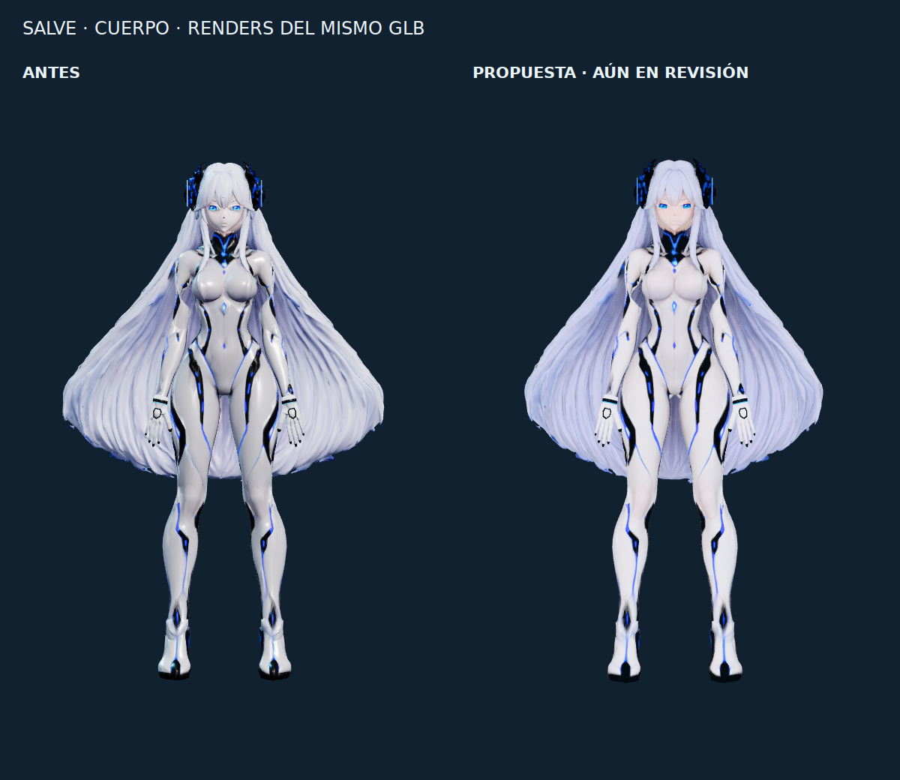
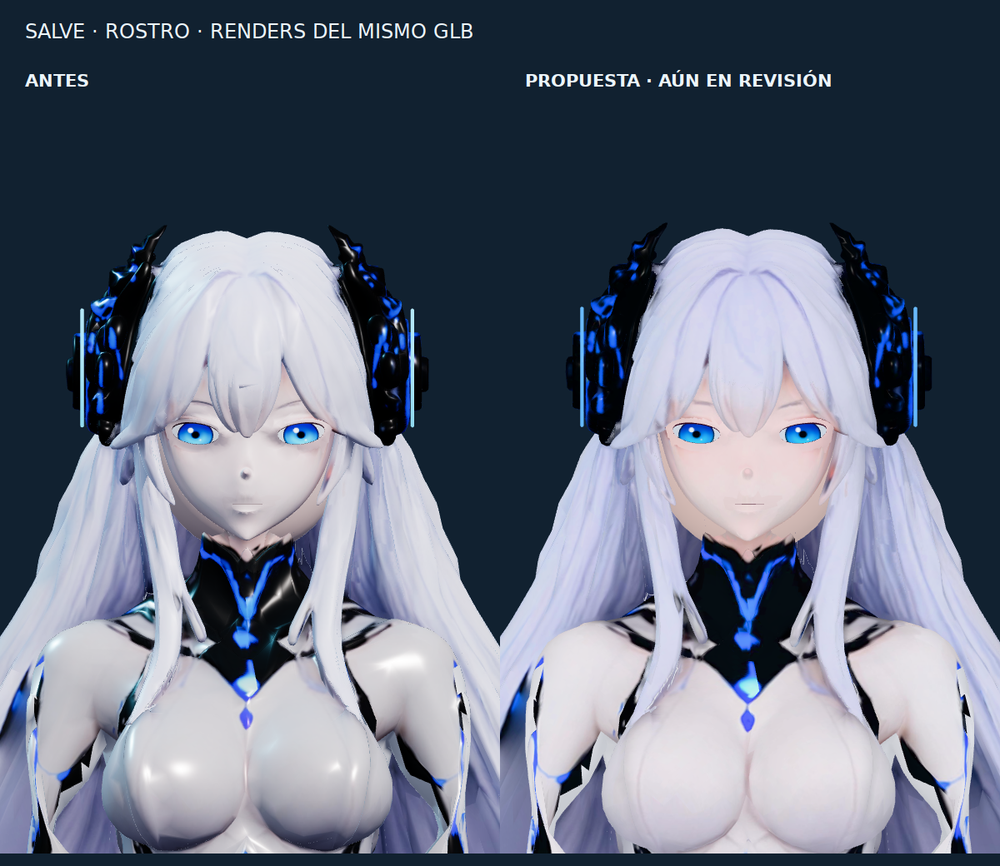

# Revisión visual de Salve en Android

La captura del teléfono coincide con el render del visor: la carga y la animación
funcionan, pero el acabado no conserva bien la expresión de la referencia.
Esta propuesta es una corrección parcial de presentación, **no una aprobación
del modelado facial ni de las manos**.





Son capturas reales del mismo GLB en Three.js, con la misma cámara y pose,
comparadas con el visor del commit `3c51dbb8295a80489f53d7db86ff9172e0d47b9e`.
No son ilustraciones generadas para representar un resultado futuro.

## Cambios

- Materiales mates para piel, cabello y partes blancas del traje; se conservan
  las texturas y colores de vértices. Las piezas negras y luces siguen separadas.
- Iluminación frontal difusa, tonos neutros e iris con menos emisión.
- Párpados ligeramente relajados, conservando el cierre completo del parpadeo.
- Ajuste gradual de la anchura de la parte inferior del cabello durante la carga
  (máximo 18 %); conserva huesos, pesos y la cobertura posterior del archivo.
- Estado inicial normalizado: evita rotaciones `NaN` antes del primer mensaje de
  Android y evita mostrar la cama cuando el estado aún no la ha solicitado.

## Verificación y límites

`npm run build --prefix tools/avatar3d` y `npm test --prefix tools/avatar3d`
correctos en Chromium: 81 huesos, 10 clips, posturas durante el habla, parada de
voz, ausencia de acumulación en el giro de cabeza, pausa/reanudación y modo flotante
sin red. Se añade la comprobación de una cabeza finita antes del primer estado nativo.

El GLB original sigue intacto, SHA-256:
`420693a1d473ad27342ad1080f564f16a51c8f76a747cd88dc37c110a0650d63`.

Persisten diferencias de modelado: contorno/delineado de ojos, transición de las
zonas reconstruidas de la cara, boca y dedos. No se considera resuelta la fidelidad
visual completa a las ilustraciones. Requieren revisar la malla y sus texturas;
la compilación correcta no sustituye esa revisión visual.

La instalación y el aspecto de esta propuesta en un teléfono todavía no están
probados. Tampoco modifica la firma de las APK ni soluciona su persistencia entre
ejecuciones de CI.

## Reproducir las comparaciones

Con el commit base disponible en el repositorio local:

```bash
npm ci --prefix tools/avatar3d
node tools/avatar3d/node_modules/playwright/cli.js install chromium
node tools/avatar3d/review-appearance.cjs 3c51dbb8295a80489f53d7db86ff9172e0d47b9e
```

Los resultados se guardan en `build/appearance-review`. El acceso a la cámara para
estas capturas solo se añade a los bundles temporales del script de revisión.
